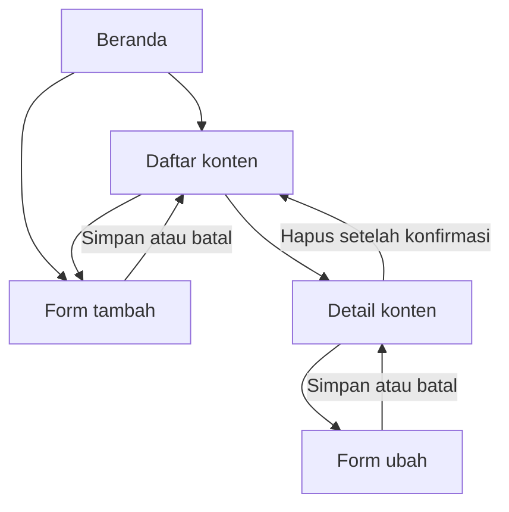

# ContentFlow

ContentFlow adalah aplikasi Flutter sederhana untuk membantu tim konsultasi digital mengelola rencana konten klien.

## Fitur

- Beranda menampilkan jumlah semua konten dan jumlah per status.
- Daftar konten menampilkan judul, klien, platform, tanggal publikasi, dan status.
- Pencarian berdasarkan judul, klien, atau platform.
- Filter status: Ide, Proses, Siap Terbit, dan Terbit.
- Detail konten menampilkan seluruh informasi dan deskripsi.
- Tambah, ubah, dan hapus konten; penghapusan meminta konfirmasi.
- Validasi wajib untuk judul konten dan nama klien.
- Pesan kondisi kosong ditampilkan jika belum ada konten atau hasil filter.

## Alur navigasi



## Data dan batasan

Data contoh dimuat langsung di `ContentStore`. Perubahan dikelola dalam `List` selama aplikasi berjalan dan tidak disimpan setelah aplikasi ditutup. Aplikasi tidak menggunakan API, database, maupun login.

## Menjalankan aplikasi

```sh
flutter pub get
flutter run
```
