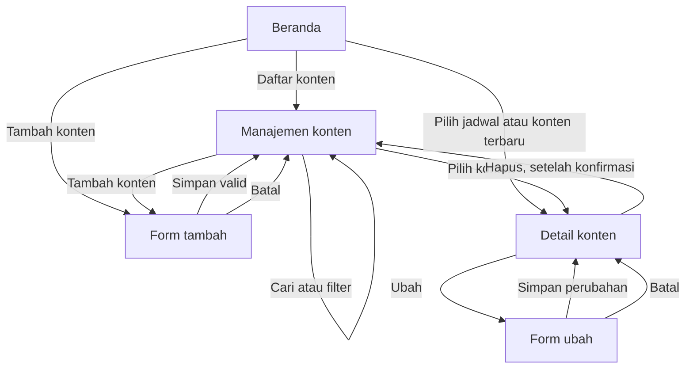

# Flowchart Navigasi ContentFlow

## Alur singkat

Beranda membuka daftar, jadwal, atau form tambah. Daftar dapat dicari dan difilter sebelum pengguna membuka detail. Detail menyediakan aksi ubah dan hapus. Form menolak penyimpanan jika judul atau nama klien kosong.
